# Kaê Chocolates · loja e clube de assinatura

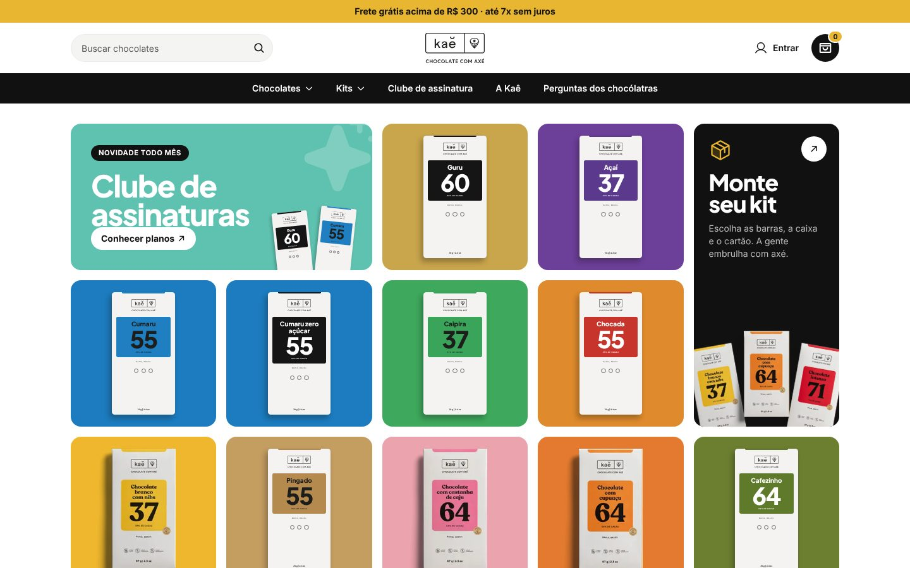

Proposta de um novo site para a [Kaê Chocolates](https://www.kaechocolates.com.br),
chocolataria bean to bar de Varginha (MG): loja completa, "Monte seu kit" e clube de
assinatura com cobrança recorrente, tudo administrável por um painel próprio.

**No ar:** [kaechocolates.luricweb.com.br](https://kaechocolates.luricweb.com.br) (pagamentos em modo de teste)

> Projeto conceito, feito como proposta de melhoria. A marca, os nomes e as fotos dos
> produtos pertencem à Kaê Chocolates. Toda a identidade fica em um só lugar
> (`src/config/brand.ts` + cores no CSS) para o projeto virar uma loja genérica se preciso.

## O ponto de partida

A Kaê vende pela Nuvemshop. O site funciona, mas a experiência é a de um tema pronto:
pouca personalidade para uma marca premiada (13 prêmios internacionais), nenhum jeito
de montar kits de presente e nenhuma assinatura, que é o modelo que mais combina com
chocolate de pequenos lotes e edições limitadas.

A proposta mantém o que já funciona para quem compra (estrutura de e-commerce, busca,
barra de categorias, mosaico colorido de sabores e fundo branco da identidade atual) e
leva o visual para perto das referências da marca, como OLIPOP e Better Booch: cor forte
por sabor, tipografia grande e embalagens como protagonistas.

## O que foi construído

| | |
| --- | --- |
| 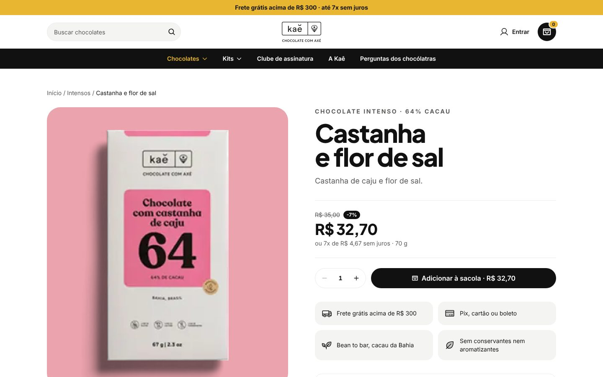 | 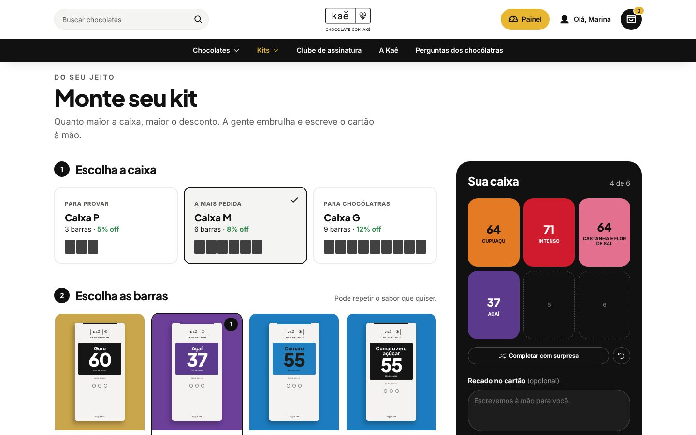 |
| **Produto**: foto ou embalagem desenhada, preço, parcelamento, frete grátis | **Monte seu kit**: caixa P, M ou G, barras repetidas, recado escrito à mão e desconto por tamanho |
| 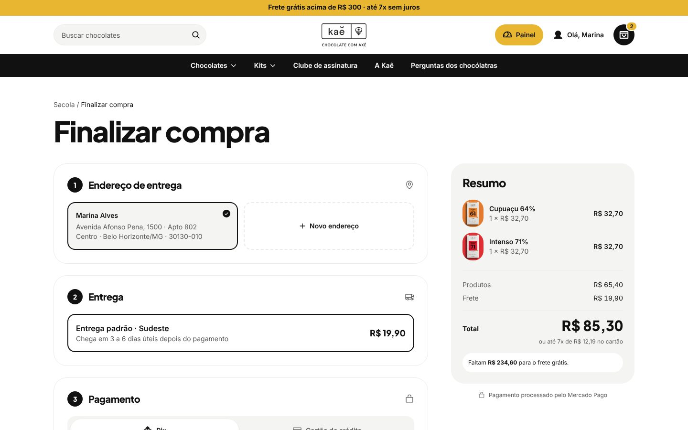 | 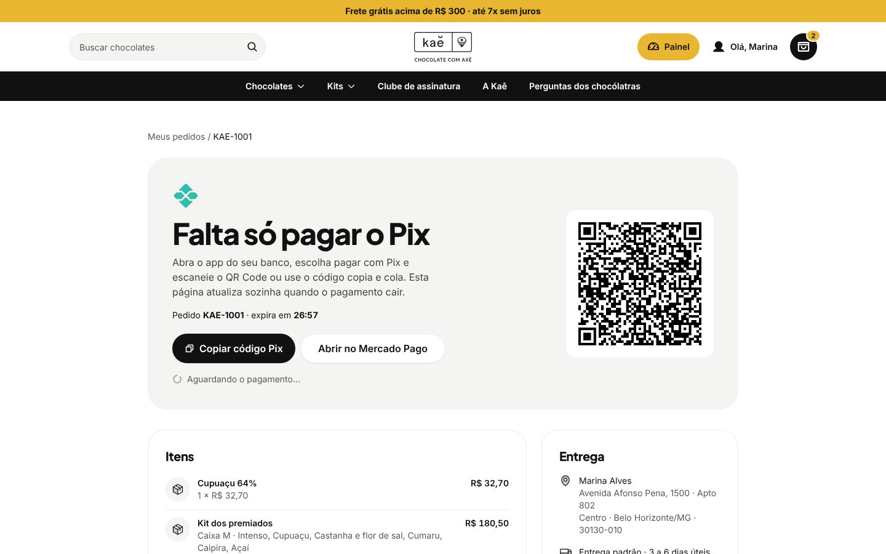 |
| **Checkout em uma página**: endereço com busca de CEP, frete por região, Pix ou cartão | **Pix**: QR Code e copia e cola; a página se atualiza sozinha quando o pagamento cai |
| 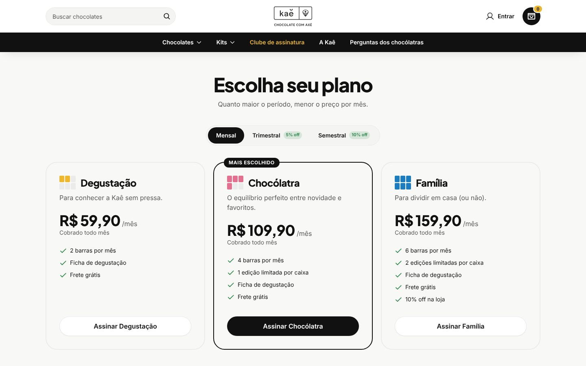 | 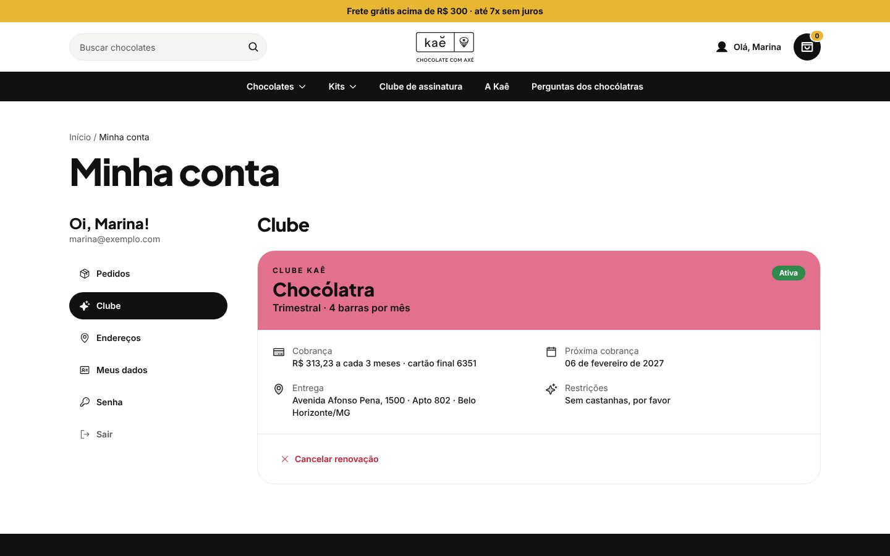 |
| **Clube**: três planos, períodos com desconto, cobrança recorrente no cartão | **Minha conta**: próxima cobrança, pausar, retomar, cancelar e histórico |
| 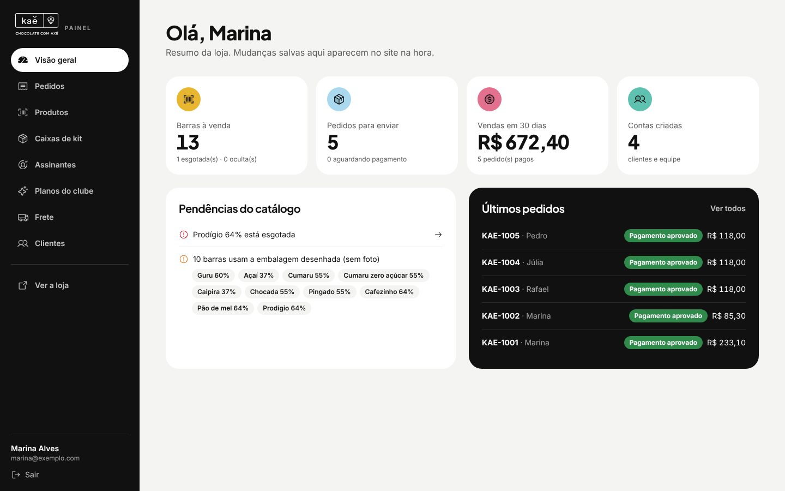 | 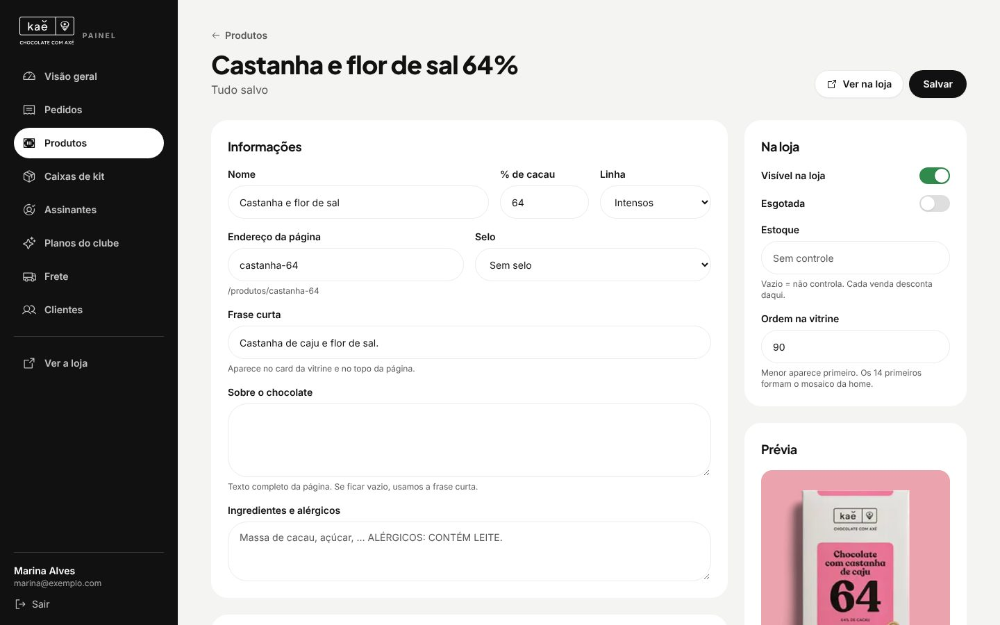 |
| **Painel**: pedidos para enviar, vendas, pendências do catálogo | **Editor de barra**: prévia ao vivo da embalagem, cores, foto, estoque e ordem na vitrine |
| 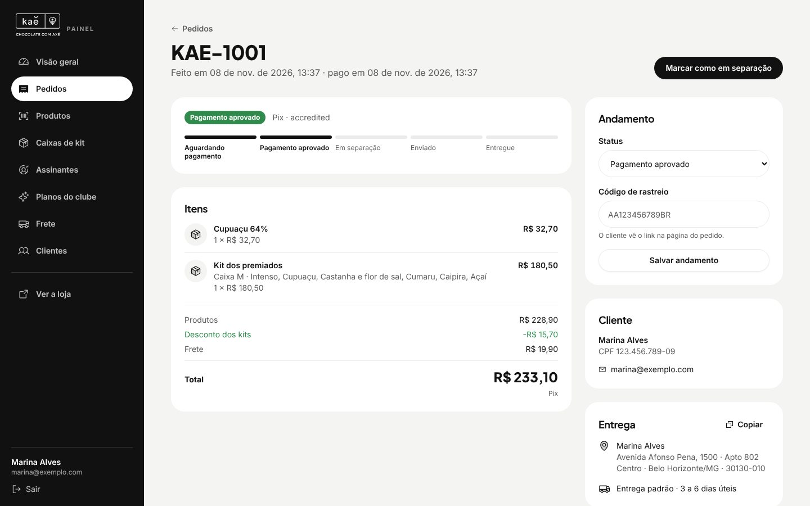 | 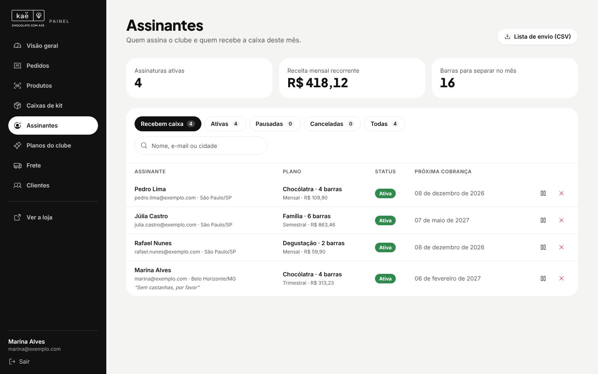 |
| **Pedidos**: andamento, rastreio, dados do cliente, endereço para copiar | **Assinantes**: receita recorrente, barras do mês e lista de envio em CSV |

<p align="center">
  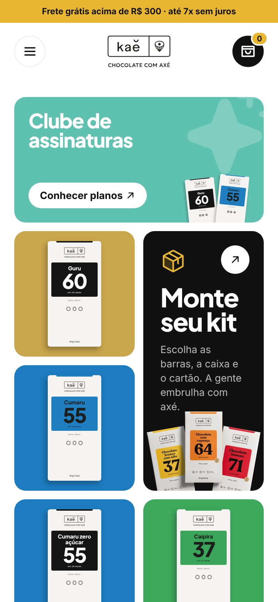
  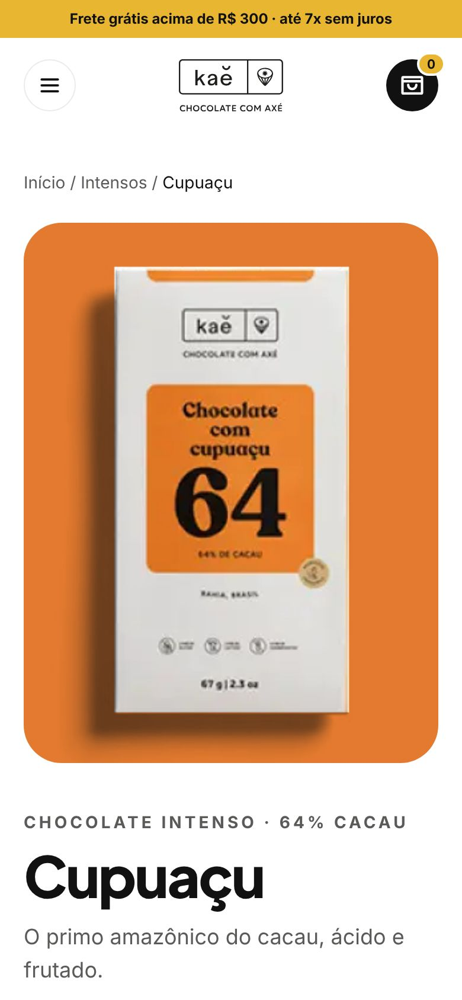
  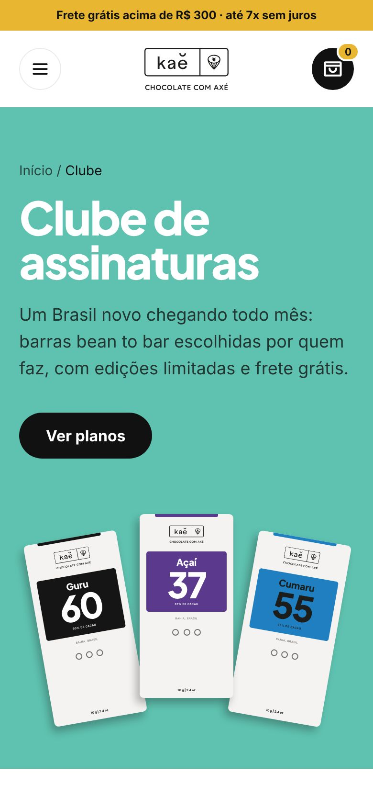
</p>

Também entraram: login e cadastro, recuperação de senha, endereços salvos, e-mails
automáticos (pedido recebido, pagamento aprovado, enviado com rastreio, boas-vindas ao clube),
política de privacidade (LGPD) e termos (CDC), SEO com sitemap, dados estruturados e imagem
de compartilhamento gerada para cada barra.

## Decisões técnicas

### O banco decide o dinheiro
O navegador manda só o que está na sacola. Preço, desconto do kit, frete, estoque e valor da
assinatura são calculados por funções do Postgres (`quote_order`, `place_order`, `club_quote`),
que clientes não conseguem chamar: só o servidor do site, com a connection string. O estoque é
reservado na compra e devolvido se o cartão for recusado, o Pix expirar ou o pedido for
cancelado. No navegador, o arredondamento de centavos segue a mesma regra do banco, para o
valor mostrado bater com o cobrado.

### Quase sem backend próprio
Leituras e gravações do dia a dia (catálogo, conta, endereços, painel) vão direto do navegador
para a Data API do Neon, com o token de quem está logado. Quem pode o quê é decidido no banco,
por RLS: visitante lê só o catálogo ativo, cliente vê só os próprios dados, admin edita.
Rotas próprias (`src/app/api`) existem só onde é preciso um segredo: cobrar no Mercado Pago,
receber webhooks, enviar fotos para o Blob e limpar o cache da loja.

### Loja rápida, painel em tempo real
O catálogo é lido no servidor e fica em cache; ao salvar no painel, o cache é limpo na hora
(`revalidateTag`), então a vitrine reflete a mudança sem esperar. Se o banco estiver fora do
ar, a loja continua de pé com um catálogo de reserva.

### Pagamento que não confia em ninguém
O webhook do Mercado Pago só serve de gatilho: o site busca o pedido ou a assinatura na API
deles e grava o status que vier de lá, nunca o do corpo do aviso. Enquanto o Pix está
pendente, a própria página do pedido confere o status, então tudo funciona mesmo se o
webhook atrasar.

### Embalagem desenhada em código
Só quatro barras tinham foto. As outras são desenhadas em CSS com container queries
(`cqw`): ficam nítidas em qualquer tamanho e usam as cores cadastradas no painel. Com isso
um sabor novo já entra na loja bonito, antes da sessão de fotos.

### Esteira de verdade
`feat/*` → `dev` → `main`. Toda PR roda lint, tipos, build, migrations do zero e testes de
ponta a ponta. O deploy sai do GitHub Actions: aplica as migrations no Neon e só depois
publica na Vercel. O deploy automático pelo Git fica desligado.

### Testes sem nenhuma conta externa
Os testes de ponta a ponta (Playwright) rodam no build de produção contra um ambiente que
sobe dentro do próprio CI: Postgres, um Better Auth no papel do Neon Auth, o PostgREST no
papel da Data API e um Mercado Pago simulado. São 14 cenários, de "comprar com Pix" a
"visitante não lê pedidos de ninguém", e não precisam de nenhum secret.

## Arquitetura

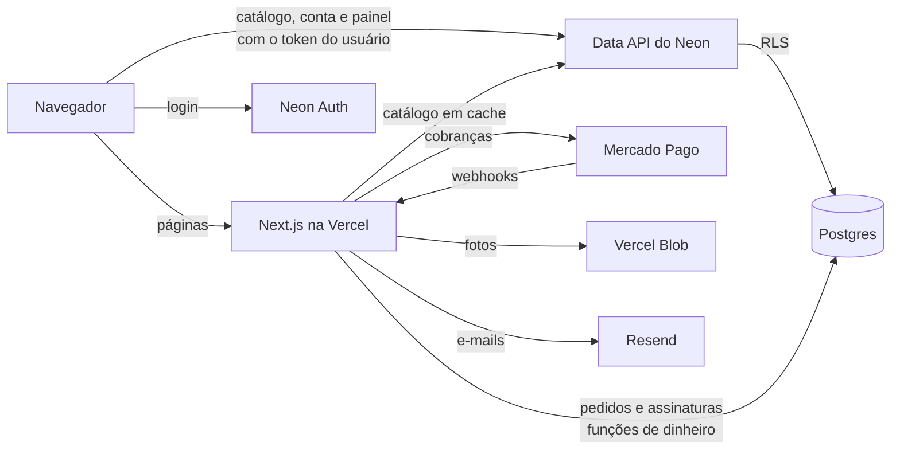

## Stack

| Camada | Tecnologia |
| --- | --- |
| Front | Next.js 16 (App Router), React 19, TypeScript, Tailwind CSS 4, componentes no padrão shadcn/ui, Phosphor Icons, Motion |
| Dados | Neon (Postgres, Neon Auth, Data API), migrations em SQL puro |
| Pagamentos | Mercado Pago: API de Orders (Pix e cartão) e assinaturas |
| Arquivos | Vercel Blob |
| E-mails | Resend |
| Qualidade | ESLint, TypeScript estrito, Playwright |
| Entrega | GitHub Actions + Vercel |

## Estrutura

```
src/
  app/            rotas (loja, conta, checkout, clube, admin) e rotas de API
  components/     componentes por área (cart, checkout, club, admin, account, ui…)
  config/brand.ts identidade da marca em um só lugar
  data/           tipos, regras de exibição e catálogo de reserva
  lib/            acesso a dados; lib/server só roda no servidor (banco, Mercado Pago)
database/
  migrations/     schema, RLS, pedidos e clube (aplicadas em ordem)
e2e/              testes de ponta a ponta e o ambiente simulado
docs/             configuração e telas
```

## Rodar e publicar

- Configuração, variáveis, migrations, deploy e como testar pagamentos: [`docs/SETUP.md`](docs/SETUP.md)
- Testes de ponta a ponta: [`e2e/README.md`](e2e/README.md)

```bash
yarn install
cp .env.example .env.local
yarn dev
```

---

Desenvolvido por [Luiz Ricardo](https://github.com/luuizz) · [Luric.web](https://luricweb.com.br)
